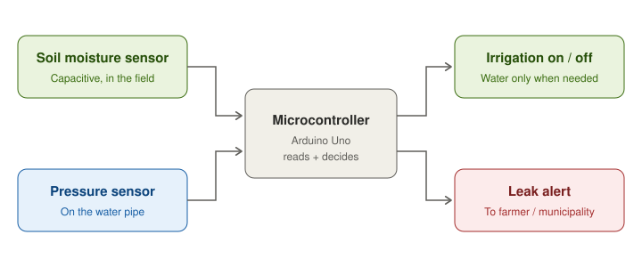

# AquaSense

**Fighting water wastage with sensors.** An IoT idea that uses soil moisture sensors to stop over-irrigation on farms, and pressure sensors to catch leaks in water pipes.

🏆 **Top 1500 in India: Youth Ideathon 2024** (ThinkStartup)
Team **Aquawarriors**: Sukhman Bhullar, Surpreet Singh, Nihaar Khurana

## The problem

India wastes about **30% of its water every year**:

- About **10%** is lost to **leaking water pipes**.
- About **70% of water used in agriculture** is wasted through **improper irrigation**: fields get watered on a fixed routine, not when the soil actually needs it.

Agriculture is by far India's biggest water user, so even a small improvement on farms saves a lot of water.

## Our solution

AquaSense puts low-cost sensors on a microcontroller that reads them and acts:

| Part | Sensor | What it does |
|---|---|---|
| **Smart irrigation** | Capacitive soil moisture sensor | Measures how wet the soil really is, and switches irrigation on only when it's dry and off once it's wet enough. |
| **Leak detection** | Pressure sensor on the pipe | Watches the water pressure. A sudden, lasting drop usually means a leak, so it raises an alert for the farmer or the municipality. |

A **capacitive** moisture sensor suits a farm better than the cheaper resistive kind: it has no exposed metal in the soil, so it doesn't corrode and lasts longer in a field.

## Estimated cost

| Component | Cost (INR) |
|---|---|
| Capacitive soil moisture sensor | 80–100 |
| Pressure sensor | 150–200 |
| Microcontroller | 80–100 |
| Wires | 50–80 |
| Miscellaneous | 100–200 |
| **Total** | **560–680** |

## Challenges we planned for

| Challenge | Our solution |
|---|---|
| High upfront cost for small farmers | Government subsidies and incentives |
| Farmers unfamiliar with the technology | Free training in local languages |
| Poor internet in rural areas | Offline mode, and low-power long-range networks (LPWANs) |

## The code

`aquasense.ino` is a **reference implementation**. It was written after the competition to show how the design would work on an Arduino Uno. Our Ideathon submission was a concept pitch.

How the logic works:

- **Irrigation uses two thresholds** (hysteresis): it switches on below 35% moisture and off above 60%. With a single threshold, the pump would flicker on and off around one value.
- **Leak detection learns "normal" pressure** as a moving average, and only raises an alert if pressure stays at least 25% below normal for 5 readings in a row. One odd reading won't trigger a false alarm.
- All thresholds are placeholders and need calibrating with real sensors.

### Wiring (Arduino Uno)

| Pin | Connected to |
|---|---|
| A0 | Capacitive soil moisture sensor |
| A1 | Pressure transducer (0.5–4.5 V) |
| D7 | Relay for the pump / valve |
| D8 | Buzzer (leak alarm) |
| D13 | Built-in LED (on while irrigating) |

### Run it

1. Open `aquasense.ino` in the [Arduino IDE](https://www.arduino.cc/en/software).
2. Select **Board → Arduino Uno** and your port, then upload.
3. Open the **Serial Monitor** at 9600 baud to see live moisture, pressure and alerts.

## What's next

- Build and test the physical prototype in a real field
- Send leak alerts by SMS or app, not just a buzzer
- Log readings over time to show farmers how much water they saved
